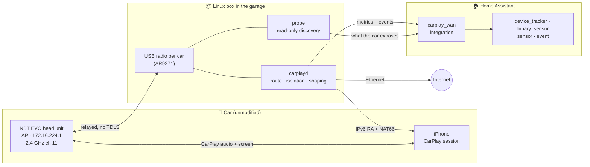
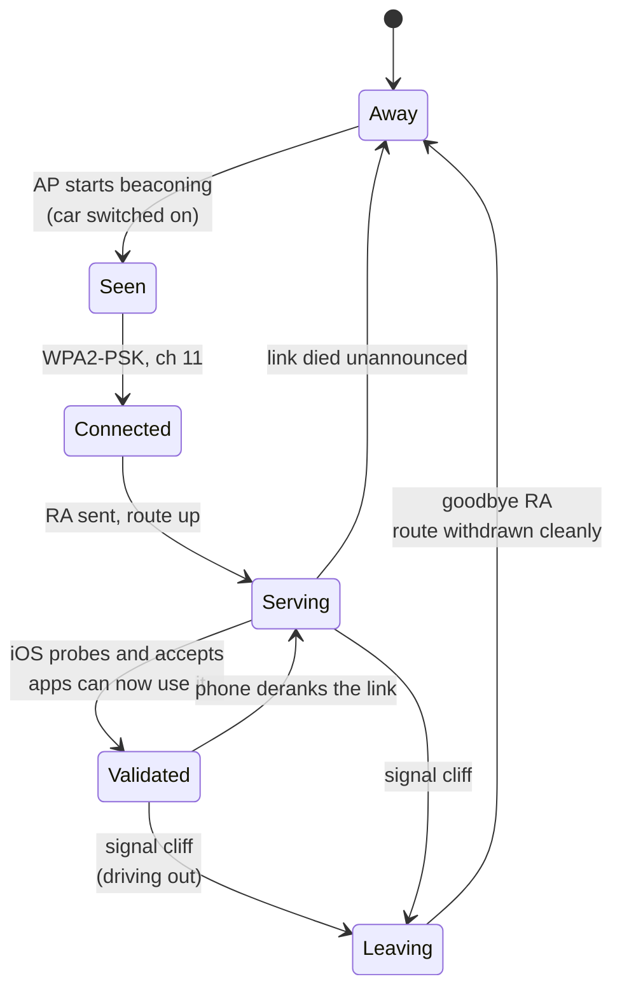
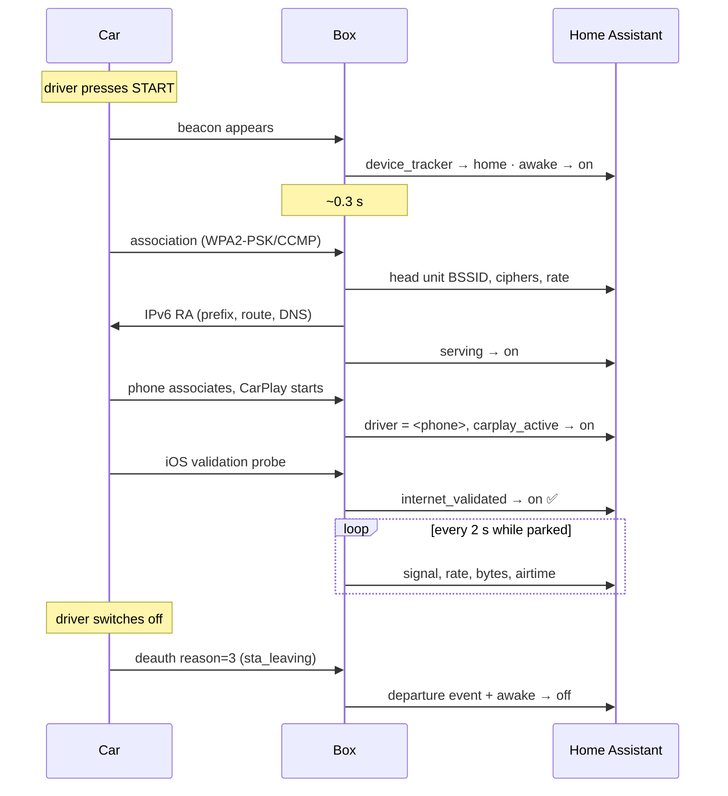
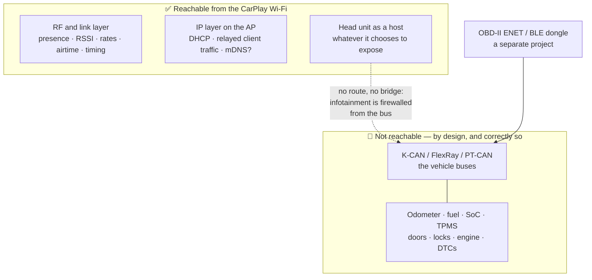
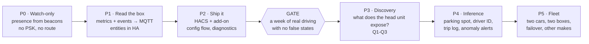

# CarPlay WAN for Home Assistant

[](#status-and-install)
[](tests/)
[](tests/)
[](#status-and-install)
[](custom_components/carplay_wan/quality_scale.yaml)
[](LICENSE.md)
[](https://hacs.xyz/docs/publish/integration)
[](https://www.home-assistant.io/)
[](https://www.python.org/)
[](https://go.dev/)
[](https://www.kernel.org/)
[](https://www.apple.com/ios/carplay/)
[](https://www.bmw.com/)
[](https://github.com/ParkWardRR/internet-over-wireless-carplay)

**Your parked car runs a Wi-Fi network. This turns it into a Home Assistant device — and gives the phone inside it a working internet connection.**

Wireless CarPlay works by having the car run its own small Wi-Fi network for the phone to talk to the dashboard. That network is a cable replacement: it carries **no internet**. This project does two things with it that nobody is doing today.

1. **It fixes the internet half.** A small Linux box joins that same car network and hands the phone a route out to your home connection. In an underground garage with no cell signal, Maps starts working again. The car is not modified and the phone's IP settings are not changed. This half is **already built and proven on two cars** — see [internet-over-wireless-carplay](https://github.com/ParkWardRR/internet-over-wireless-carplay).
2. **It reads the car.** The same radio link is a rich, honest sensor. It knows when the car woke up, when it left, where it parked, who was driving, whether CarPlay was running and how hard it was working — all of it underground, where GPS, cellular and every cloud API are dead.

> **For newcomers:** think of it as a motion sensor for your car that happens to also be a Wi-Fi router.
> **For pros:** it is a `wpa_supplicant` STA on the head unit's AP, an RFC 4861 RA sender with NAT66, nftables isolation per car link, and an event stream from `nl80211` station dumps — surfaced as HA entities.

---

## In one picture



Two data paths, one radio link. The **route** goes to the phone. The **telemetry** goes to Home Assistant.

---

## What you get in Home Assistant

The payoff first. Every row below is derived from something the upstream project already measures on real cars.

| Entity | Type | What it tells you | Confidence |
|---|---|---|---|
| `device_tracker.f32` | device_tracker | **Car is home / away.** Works in a basement where GPS and cellular do not | ✅ measured |
| `binary_sensor.f32_awake` | binary_sensor | **Ignition or accessory is on.** The CarPlay AP only exists while the car is awake; it stops beaconing seconds after you switch off | ✅ measured |
| `binary_sensor.f32_carplay_active` | binary_sensor | A phone is actually in a CarPlay session, not just nearby | ✅ measured |
| `binary_sensor.f32_internet_validated` | binary_sensor | iOS has accepted the link and **apps will use it**. The single most useful bit in the whole system — see [the tap](#the-tap-the-one-thing-that-catches-everyone) | ✅ measured |
| `sensor.f32_signal` | sensor (dBm) | Link strength. In practice a **parking-position** proxy: a car six feet left of usual reads 10 dB different | ✅ measured |
| `sensor.f32_driver` | sensor | **Which phone attached**, by MAC → who is driving | ✅ measured |
| `sensor.f32_session_duration` | sensor (s) | How long the car has been awake this time | ✅ measured |
| `sensor.f32_forwarded_bytes` | sensor (B) | What the phone pulled through your house | ✅ measured |
| `sensor.f32_carplay_airtime` | sensor (%) | How much of the channel CarPlay is eating. Median **26.5%** on these cars | ✅ measured |
| `sensor.f32_link_rate` | sensor (Mbit/s) | Negotiated MCS rate — the honest health number on this hardware | ✅ measured |
| `sensor.f32_head_unit` | sensor | Head unit BSSID, OUI, negotiated ciphers, Wi-Fi generation | ✅ measured |
| `event.f32_arrival` / `event.f32_departure` | event | Timestamped trip boundaries, with signal trace | ✅ measured |
| `sensor.f32_services` | sensor | What the head unit advertises on the link (mDNS, open ports) | 🔬 **research — see [Q2](#q2-what-does-the-head-unit-actually-expose)** |

**Automations this makes trivial, that are hard today:** open the garage door when the car wakes up two floors underground; turn the house lights on *when the engine starts* rather than when a phone's GPS drifts near home; log every trip's start and end with no OBD dongle and no manufacturer cloud account; alert when a car has been awake for 20 minutes without leaving (someone sitting in the garage with the engine running).

---

## How it works

### Half one: the route (built, proven)

The car hands out IPv4 with **no router and no DNS**, and sends no router advertisements of its own. So the box does not fight it — it leaves IPv4 alone and becomes the only IPv6 router on the link, advertising a ULA prefix, itself as the gateway, and a DNS server, then NATs out to the house over Ethernet. The phone picks that up with plain SLAAC. Nothing is configured on the phone.



Every transition in that diagram is an event the integration turns into an HA state change. The hard-won part is `Leaving`: departures from a basement garage do not fade politely, the signal stays flat and then the link simply dies — so leaving *early enough to say goodbye* took three instrumented drives to get right, and is [still not fully solved](#q4-what-signal-replaces-a-counter-the-driver-does-not-implement).

### Half two: the telemetry (this repo's new work)



The integration never talks to the car. It consumes what the box already produces: a Prometheus endpoint (`carplayd_serving`, `carplayd_signal_dbm`, `carplayd_phones`, `carplayd_phone_probe_bytes`, `carplayd_phone_forward_bytes`, `carplayd_detect_seconds`, `carplayd_upstream`, `carplayd_events_total`) and a structured event log. The planned transport is a thin local API plus MQTT discovery, so the box and HA do not have to be the same machine.

---

## What you can and cannot learn about a car over Wi-Fi

**This is the section to read before you get excited.** The honest answer has three tiers, and most people assume tier 3 is available when it is not.



### Tier 1 — certain, already measured

Presence, wake/sleep, arrival and departure timestamps, dwell time, signal strength and its trajectory, which phones attached and when, CarPlay session activity, negotiated ciphers and Wi-Fi generation, link rates, channel occupancy, bytes moved, and whether iOS validated the route. All of this is observable from the box with no cooperation from the car, and the upstream project has logs of every one of it on two vehicles.

### Tier 2 — plausible, unverified, and the interesting research

CarPlay's own service discovery runs over **Bonjour/mDNS**, with several TCP streams for AirPlay and a UDP stream for time sync ([TROOPERS 2024 analysis](https://troopers.de/downloads/troopers24/TR24_Apple_CarPlay-What's_Under_the_Hood_8MCYKG.pdf)). That means there is almost certainly an mDNS responder on the link. What an NBT EVO advertises in its TXT records — firmware string, model, capabilities, vehicle identifiers — **has never been published, and we have not looked yet.** That is [Q2](#q2-what-does-the-head-unit-actually-expose), and it is the single highest-value experiment in this repository.

### Tier 3 — not available here, and do not let anyone tell you otherwise

Odometer, fuel level, state of charge, tyre pressures, door and lock states, DTCs, VIN beyond the five digits in the SSID, and anything else from the vehicle bus **are not on this network**. Infotainment Wi-Fi is deliberately not bridged to K-CAN or FlexRay, and that separation is a safety property you should want. Published BMW head-unit research reaches the bus through a *different* physical path — KeenLab found the NBT acting as a gateway at `192.168.0.1` over **USB Ethernet**, not over the CarPlay AP ([KeenLab, 2018](https://keenlab.tencent.com/en/whitepapers/Experimental_Security_Assessment_of_BMW_Cars_by_KeenLab.pdf); [Black Hat USA 2019](https://i.blackhat.com/USA-19/Thursday/us-19-Cai-0-Days-And-Mitigations-Roadways-To-Exploit-And-Secure-Connected-BMW-Cars-wp.pdf)).

**If you want bus data, use an OBD-II dongle and a separate integration, and let this one do what only it can do.** The two complement each other cleanly: OBD-II tells you the car's internals while it is running; this tells you the car is *there*, underground, where the dongle's uplink has no signal.

---

## The tap: the one thing that catches everyone

iOS gives a CarPlay network the **lowest possible service rank**. It gets a limited route that background daemons use and your apps ignore. The box can be working perfectly and Maps will still fail — on one instrumented drive, 1.36 MB moved through the box and not one user-facing app touched it.

The fix is one tap, once: **Settings → Wi-Fi → the car's network → Check For Internet Access → Use For Internet.**

| | |
|---|---|
| Does iOS re-validate by itself afterwards? | **Usually.** Across absences of 15–29 minutes, validation returned **4–24 s** after the box resumed serving, with no tap |
| Always? | **No.** Two sessions in one morning never validated and moved zero bytes, and a 54-minute car restart needed the tap again |
| So? | Treat the tap as required and the re-check as a bonus. `binary_sensor.*_internet_validated` exists precisely so Home Assistant can tell you which state you are in, instead of you guessing from a dead Maps screen |

This is also why the integration exposes validation as a first-class entity rather than burying it: **a notification saying "the car has no working route, tap the switch" is worth more than any other automation here.**

---

## Hardware

| Part | Why | Notes |
|---|---|---|
| A small Linux box | Runs the add-on | Raspberry Pi, Orange Pi, or the HA host itself if it is Linux with USB |
| **One 2.4 GHz USB Wi-Fi adapter per car** | A radio cannot serve two cars at once | AR9271 (`ath9k_htc`) is the known-good, ~$15. **They cannot be shared** |
| Wired Ethernet to the box | The uplink the phone borrows | Wi-Fi uplink on the same band will fight the car link |
| An iPhone on **iOS 27+** | *Use For Internet* does not exist before it | Required for the route half, not the telemetry half |
| The car's CarPlay Wi-Fi password | To join at all | Settings → Wi-Fi → Edit → Known Networks → the car → Password. No jailbreak |

**Telemetry-only mode needs none of the above except a radio.** If you do not care about the internet half, the box can watch the car's beacons without ever associating — you get presence, wake/sleep, RSSI and timing with no password and no route. That is a planned first-class mode, because it is the fastest possible path to value and has no failure modes that can touch CarPlay.

---

## Status and install

**Alpha.** The agent and the integration both exist and both have been run against real hardware. What has *not* happened is a week of real driving, which is the gate in the roadmap. Treat it as something to try, not something to depend on.

| Piece | State |
|---|---|
| `box/carplay_wan_agent.py` | Runs. 23 unit tests on fixtures copied from real logs; verified against the live box |
| `box/probe/headunit-probe.sh` | Written, fires on arrival. **Has not yet caught a car** — see [Q2](#q2-what-does-the-head-unit-actually-expose) |
| `custom_components/carplay_wan` | **45 tests, 99% coverage** against **Home Assistant 2026.2.3**; every entity key verified against a live agent payload |
| End-to-end in a running HA | ⬜ **not yet done.** Nobody has clicked through the config flow on a real install |

**Quality scale: no tier, and that is the honest answer.** Home Assistant's [integration quality scale](https://contributors.home-assistant.io/core/quality-scale/) grades *core* integrations — hassfest enforces it inside the core repository, and `custom` is the manifest value for everything outside it. Nothing official grades a HACS integration. The rules are still the best checklist there is, so [`quality_scale.yaml`](custom_components/carplay_wan/quality_scale.yaml) fills in all 54 of them as if this were being reviewed: **31 done, 9 exempt, 14 todo**. Every Bronze and Silver rule is met except one — `brands`, which needs an icon submitted to a repository that is not this one. Gold is deliberately still open; `repair-issues` and `docs-troubleshooting` are worth real thought rather than box-ticking.

### 1. The agent, on the box

It reads what carplayd already knows and serves one JSON endpoint. Standard library only — the box has Python 3.11 and nothing installed, and it stays that way.

```sh
sudo install -m 755 box/carplay_wan_agent.py       /usr/local/bin/
sudo install -m 755 box/probe/headunit-probe.sh    /usr/local/libexec/
sudo install -m 600 box/agent.example.env          /etc/carplay-wan-agent.env   # edit this
sudo install -m 644 box/carplay-wan-agent.service  /etc/systemd/system/
sudo systemctl enable --now carplay-wan-agent
```

Check it before going near Home Assistant. `--once` prints a snapshot and exits:

```sh
sudo carplay_wan_agent.py --car A=F32 --car B=F22 --once
```

**Watch mode needs no password and never associates** — beacons only, so it cannot disturb CarPlay. This is the whole product if you only want to know whether the car is home, and it should work on any car whose AP appears when it wakes:

```sh
sudo carplay_wan_agent.py --car A=F32="BMW00000 CarPlay" --watch-dev cara
```

### 2. The integration, in Home Assistant

HACS → ⋮ → Custom repositories → `https://github.com/ParkWardRR/ha-carplay-wan`, type Integration. Then **Settings → Devices & Services → Add Integration → CarPlay WAN**, and give it the box's address and port 8099. No YAML. One device per car.

Prefer not to install a custom integration? Start the agent with `--mqtt-host` and it publishes MQTT discovery instead; stock HA builds the same entities with no custom code. The HTTP endpoint and MQTT are two transports over one state machine, not two implementations.

### Uninstalling

Removing the config entry in Home Assistant removes the entities. It does **not** touch the box, which is the part people forget:

```sh
sudo systemctl disable --now carplay-wan-agent
sudo rm /etc/systemd/system/carplay-wan-agent.service /etc/carplay-wan-agent.env
sudo rm /usr/local/bin/carplay_wan_agent.py /usr/local/libexec/headunit-probe.sh
sudo rm -rf /var/lib/carplay-wan      # state, probe results, and the redaction salt
sudo systemctl daemon-reload
```

`carplayd` itself is untouched by all of this — the agent only ever read from it.

### What it looks like on the wire

```json
{ "agent": { "version": "0.1.0", "metrics_ok": true, "redacted": true },
  "upstream": true,
  "cars": { "A": { "name": "F32", "present": true, "serving": true,
                   "validated": true, "signal_dbm": -58, "phones": 1,
                   "forwarded_bytes": 1255890, "head_unit": "bssid-9f21c0ab4e",
                   "state": "home" } } }
```

`head_unit` is hashed with a per-install salt. That is the default, and `--reveal` is the only way to change it.

---

## What is in here

```
box/                            runs on the Linux box, not in Home Assistant
  carplay_wan_agent.py          the state machine. stdlib only, Python 3.11+
  carplay-wan-agent.service     systemd unit, hardened
  agent.example.env             configuration; a secret, because of the SSID
  probe/headunit-probe.sh       Q2: read-only discovery, fired on arrival
  tests/test_agent.py           23 tests on fixtures copied from real logs
custom_components/carplay_wan/  the HACS integration
  coordinator.py                polls the agent. never talks to the car
  device_tracker.py             is the car home
  binary_sensor.py              awake · route up · internet validated
  sensor.py                     signal · phones · bytes · rate · head unit
  diagnostics.py                redacted twice, on purpose
hacs.json  manifest.json        HACS and Home Assistant metadata
```

The split is the design. Anything that touches the car link lives on the box, where airtime can be reasoned about; Home Assistant polls a JSON endpoint on the LAN and never goes near the car's channel.

## Privacy and secrets — read this before you publish anything

This project's upstream leaked secrets twice, and the lessons are baked in here from the start rather than learned again.

- **The SSID contains the last five digits of your VIN.** `BMW12345 CarPlay` is not a neutral string. The integration must redact it by default in logs, diagnostics and entity attributes, and the repo must never carry a real one.
- **The PSK is a credential to a network inside your car.** It belongs in Home Assistant's secret storage, never in YAML you share, never in a diagnostics dump, never in an issue report.
- **MAC addresses identify people.** "Which phone attached" is "who was driving". That entity is genuinely useful and genuinely sensitive; it will be opt-in, hashed by default, with the raw value behind an explicit setting.
- **Diagnostics downloads are the trap.** HA's `async_get_config_entry_diagnostics` is the most common way a project like this leaks a credential, because users paste them into public issues. Redaction there is a correctness requirement, not a nicety, and it gets a test.
- **Scanning.** Any discovery this repository ships is read-only, rate-limited and confined to the car link — and it runs against **a head unit you own**. The nftables policy from upstream already permits the car link to reach the internet and nothing else: not the box, not the home LAN, not the other car.

---

## Roadmap

Ordered so the cheapest thing that could kill an idea runs first, and so nothing starts before the thing that justifies it has passed.



| # | Phase | Delivers | Accepted when |
|---|---|---|---|
| **P0** | **Watch-only presence** | ◐ **built** (`--watch-dev`): scans one channel for the car's beacon, no association, no password, no route | ⬜ A car's arrival and departure reflected in HA within 5 s, across 20 consecutive trips, with zero false "away" while parked. **Not yet run against a car** |
| **P1** | **Read the box** | ◐ **built**: tier-1 entities from carplayd's metrics and event log, over HTTP *and* MQTT discovery | ⬜ Every entity in [the table](#what-you-get-in-home-assistant) populates on a real car, and survives a box restart and an HA restart without orphaned entities |
| **P2** | **Ship it** | ◐ `hacs.json`, manifest, config flow, redacted diagnostics and tests exist. Missing: the add-on wrapper and a release | ⬜ A clean HA install can add it from HACS and reach a working state with no YAML and no shell access |
| **GATE** | **A week of real driving** | Nothing. This is the gate | Seven days, two cars, no false presence, no stuck sensors, no entity spam in the recorder, and a diagnostics dump that is provably clean of PSK, SSID digits and raw MACs |
| **P3** | **Discovery** | Answers to [Q1–Q3](#open-questions): mDNS inventory, port fingerprint, beacon elements. `sensor.*_services` moves from research to measured | Three or more head units surveyed, with a published, reproducible method and a decoder in the repository |
| **P4** | **Inference** | Parking-spot classification from RSSI fingerprints, driver identification, a trip log, and anomaly alerting ("awake 20 min, never left") | Each inference carries a stated accuracy measured against ground truth the owner recorded, not a vibe |
| **P5** | **Fleet** | Two boxes with bounded failover, more than two cars, and a porting guide for other makes | A second make of head unit works, or the guide explains precisely why it cannot |

---

## Open questions

Research that has not been done, written so somebody can actually do it. Each one states what is unknown, why it matters, and what would settle it.

### Q1. Can presence be read without ever joining the car's network?
**Unknown:** how reliably a passive monitor-mode listener can track wake, sleep, arrival and departure using beacons alone, with no PSK.
**Why it matters:** this is the whole product for anyone who does not want the internet half, it needs no credential, and it cannot possibly disturb CarPlay. It would also work on **any** car with a wireless-CarPlay or hotspot AP, not just BMWs.
**How to settle it:** `recon/airtime` upstream already does per-frame accounting in monitor mode. Point it at beacons only, log over 20 trips, compare against `carplayd`'s association events as ground truth.
**Unlocks:** P0, and a version of this that works on cars nobody here owns.

### Q2. What does the head unit actually expose?
**Unknown:** the mDNS service inventory, TXT records, and open TCP/UDP ports of an NBT EVO on its own CarPlay AP. CarPlay's discovery is Bonjour-based, so a responder is near-certain; its contents are unpublished.
**Why it matters:** it is the only plausible route to *vehicle-identifying* data over this link — firmware version, model, capabilities. If TXT records carry anything stable, `sensor.*_head_unit` becomes genuinely rich instead of a BSSID.
**How to settle it:** `box/probe/headunit-probe.sh` now does exactly this, and the agent fires it the moment a car arrives — because **nobody can run it on demand**: the AP only exists while the car is awake, so there is no "park it and scan" option. It browses mDNS on the car interface, tries one connect against a short port list, dumps the beacon for upstream's `ieaudit`, and writes JSON under `/var/lib/carplay-wan/probe/`. It has not caught a car yet. Decode and publish. Compare with the only comparable public data point: a Kenwood unit showed TCP 22/7000/8086/8888/5355 and UDP 67/5353/5355 ([ZDI, 2026](https://www.thezdi.com/blog/2026/1/8/breaking-down-the-attack-surface-of-the-kenwood-dnr1007xr-part-two)).
**Unlocks:** P3, and tier 2 moves to tier 1 or gets deleted honestly.

### Q3. Is there anything in the beacon worth reading?
**Known:** the 802.11u Interworking **Internet bit is clear** and there is **no Apple Device IE** — measured on both cars.
**Unknown:** whether vendor-specific elements carry anything identifying, and whether that differs by head-unit firmware.
**How to settle it:** upstream already ships `recon/ieaudit`, a decoder for exactly these elements. Run it across every head unit available.

### Q4. What signal replaces a counter the driver does not implement?
**Known, and currently a live defect:** the clean-leave rule watches `tx_failed`, and `ath9k_htc` **does not implement that counter** — it reads 0 forever. Every leave on the current radios comes from a signal rule instead.
**Why it matters here:** `event.*_departure` is only as good as the box's ability to notice a departure. A late departure event is a wrong trip log and a garage door that closes at the wrong moment.
**How to settle it:** the MCS rate collapsing to the 1.0 Mb/s floor is visible on both drives that failed and is the obvious candidate; `tx_packets` flatlining while the link is up is the second. Needs a departure capture on a USB radio.

### Q5. How much does watching cost the thing being watched?
**Known:** CarPlay uses **26.5%** of the channel at the median, the head unit relays every byte twice over the air, and saturating it **dropped CarPlay entirely** and needed a hard reset to re-pair. The box therefore caps its own traffic.
**Unknown:** the airtime cost of *telemetry* specifically — polling station dumps, mDNS queries, any port scan — as distinct from the route.
**Why it matters:** an integration that degrades CarPlay to produce a pretty graph is a bad trade, and the failure is loud and physical.
**How to settle it:** `recon/airtime` from inside the car, with the integration polling at each candidate interval. Publish a cost-per-poll number and pick the interval from it.

### Q6. Does any of this generalise beyond the NBT EVO?
**Known:** there are two kinds of wireless-CarPlay car. **Wi-Fi pairing** cars run CarPlay over the vehicle's own hotspot, internet included — those need none of this. **Bluetooth pairing** cars like the NBT EVO use a private CarPlay-only network with no internet, which is why this exists ([Audi TSB](https://static.nhtsa.gov/odi/tsbs/2021/MC-10189148-0001.pdf)).
**Unknown:** which makes fall on which side, and whether the telemetry half works on *both* — it should, since it only needs an AP that exists when the car is awake.
**How to settle it:** a public compatibility table that anyone can add a row to, starting with the two cars here.

### Q7. What is the right entity model for a thing that is absent most of the time?
**Unknown, and a genuine Home Assistant design question:** a car is away 95% of the time. Should sensors go `unavailable`, hold their last value, or report zero? Wrong answers produce recorder spam, broken statistics and false automations.
**Why it matters:** it decides whether long-term statistics are meaningful and whether the database grows without bound.
**How to settle it:** prototype both in P1 and look at the actual recorder growth and statistics quality over a week. Document the choice and the reason.

---

## How claims are labelled

Inherited from upstream, and enforced here. Every factual claim in this repository is one of:

| Label | Means |
|---|---|
| **measured** | Observed on a real car, phone or box, with a date and a log |
| **source** | Read from code, a specification or a vendor document, with a link |
| **emulator** | Reproduced on Linux stand-ins — which can tell you nothing about iOS behaviour |
| **inferred** / **hypothesis** | Reasoning. Explicitly not evidence |

Everything in [What you get](#what-you-get-in-home-assistant) marked ✅ is **measured on two BMW F-series cars with factory NBT EVO head units and one iPhone on iOS 27**, in one garage. That is a solid data point, not a universal law. Conclusions that turned out to be wrong are kept and marked wrong rather than quietly edited out.

---

## Prior art

Searched before building, because the most likely outcome of any project is that someone has already done it.

| What exists | How it differs |
|---|---|
| [HAPT](https://github.com/oxan/hapt) and OpenWrt join/leave scripts | Track *clients of your AP*. The car is not a client of your AP; it **is** an AP. Opposite direction |
| UniFi / MQTT device trackers | Same inversion, plus they need the car to join home Wi-Fi, which a CarPlay AP never does |
| Manufacturer cloud integrations (BMW ConnectedDrive and friends) | Rich bus data, but they need signal at the car and a vendor account, and they are exactly what fails in an underground garage |
| OBD-II dongles | Real vehicle data, complementary to this, and dependent on their own uplink |
| Community threads on car-hotspot presence | Several people have noticed the idea; the recurring complaint is that it only works while the car is on — which, for wake/sleep detection, **is the signal, not the limitation** |

No public implementation was found of a box on a factory CarPlay network providing a route, nor of anything using that link as a Home Assistant sensor. Not finding something is not proof that nobody has done it.

---

## Related projects

- **[internet-over-wireless-carplay](https://github.com/ParkWardRR/internet-over-wireless-carplay)** — the upstream. `carplayd`, the measurements, the test log, and the wiki. Everything marked ✅ here was proven there.
- Its **[wiki](https://github.com/ParkWardRR/internet-over-wireless-carplay/wiki)** — setup, how it works, what the car's network is, troubleshooting by symptom.

## Contributing

The useful contribution is a **dated entry saying what you ran, on what hardware, and what happened** — especially if it contradicts something here. A compatibility row for a car nobody here owns is worth more than a refactor.

Please never attach a diagnostics dump, log or screenshot containing a real SSID, PSK or MAC to an issue.

## License

[Blue Oak Model License 1.0.0](LICENSE.md) — permissive, plainly worded, [OSI-approved](https://opensource.org/license/blueoak-1-0-0), SPDX `BlueOak-1.0.0`.
