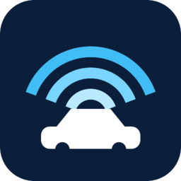
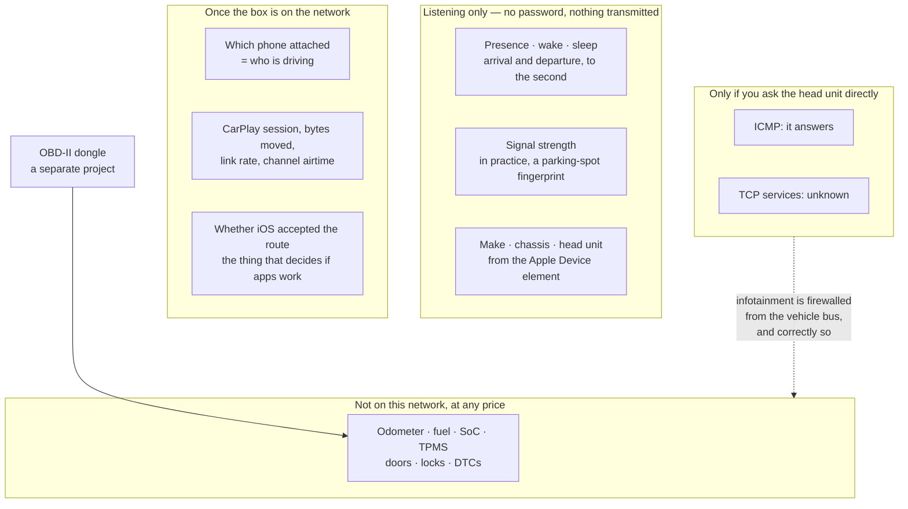
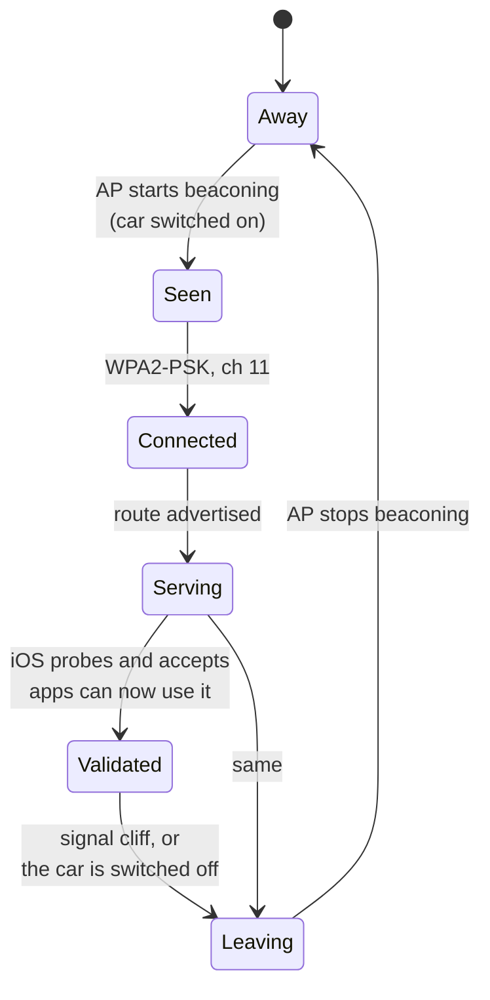

# carplay-wan

[](#status)
[](LICENSE.md)
[](box/tests/)
[](https://github.com/ParkWardRR/ha-carplay-wan/actions/workflows/ci.yml)
[](https://www.python.org/)
[](https://www.kernel.org/)
[](https://www.apple.com/ios/carplay/)
[](https://www.bmw.com/)
[](https://github.com/ParkWardRR/internet-over-wireless-carplay)

**Your parked car runs a Wi-Fi network. This finds out what it will tell you, and turns that into something a home automation system can read.**

Wireless CarPlay works by having the car run its own small Wi-Fi network so the phone can talk to the dashboard. [internet-over-wireless-carplay](https://github.com/ParkWardRR/internet-over-wireless-carplay) puts a Linux box on that network and gives the phone a route to the internet, which is what makes Maps work in a garage with no cell signal.

This repository is the other half: **the same radio link is a sensor, and a surprisingly talkative one.** It knows when the car woke up, where it parked, who got in, and — it turns out — what car it is.

> **For newcomers:** a motion sensor for your car that works two floors underground, where GPS and every phone app are dead.
> **For pros:** a state agent over `carplayd`'s event stream and metrics, plus a budgeted, read-only 802.11/IP discovery battery, exposed as JSON over HTTP and optional MQTT discovery.

---

## The headline finding

**The car announces what it is, in the clear, in every beacon.** Measured 2026-11-19 on an F32.

Decoding the Apple Device information element out of the beacon gives:

| Field | Value |
|---|---|
| Name | `BMWCarPlay` |
| Manufacturer | `BMW` |
| Model | `F32-NBTEvo-0716` — chassis, head unit, and what looks like a build date |
| Also | the head unit's BSSID, and a second MAC that is almost certainly its Bluetooth radio |

This needs **no password, no association, and transmits nothing.** A radio listening on channel 11 can identify the make, chassis and head unit of any car that wakes up nearby. It is also almost certainly not BMW-specific: the Apple Device element is a CarPlay mechanism.

It corrects the upstream project, which recorded "no Apple Device IE" as measured fact. There is one, and it is in the beacon.

---

## What else the link will tell you



### What is not on this network, and never will be

Odometer, fuel level, state of charge, tyre pressures, doors, locks, DTCs, VIN. Those live on the vehicle bus. Infotainment Wi-Fi is not bridged to K-CAN or FlexRay, and that separation is a safety property you should want. Published BMW head-unit research reaches the bus by a different physical path — [KeenLab](https://keenlab.tencent.com/en/whitepapers/Experimental_Security_Assessment_of_BMW_Cars_by_KeenLab.pdf) found the NBT acting as a gateway over **USB Ethernet**, not over the CarPlay AP.

**If you want bus data, use an OBD-II dongle.** The two complement each other: OBD tells you the car's internals while it runs; this tells you the car is *there*, underground, where the dongle's uplink has no signal.

---

## What the agent reports

`box/carplay_wan_agent.py` keeps a state machine per car and serves it as JSON over HTTP, with optional MQTT discovery for anything that speaks it.

```json
{ "agent": { "version": "0.1.0", "metrics_ok": true, "redacted": true },
  "upstream": true,
  "cars": { "A": { "name": "F32", "present": true, "serving": true,
                   "validated": true, "signal_dbm": -58, "phones": 1,
                   "forwarded_bytes": 1255890, "head_unit": "bssid-9f21c0ab4e",
                   "state": "home" } } }
```

| Field | Means |
|---|---|
| `present` | The AP is beaconing, which it only does while the car is awake. **Ignition proxy.** |
| `state` | `home` / `not_home` — works in a basement, which no GPS tracker does |
| `validated` | iOS has accepted the link and **apps will actually use it**. The single most useful bit here |
| `serving` | The box is advertising a route to the phone |
| `signal_dbm` | Link strength; in practice a parking-position fingerprint |
| `phones` | How many phones attached — and which, if you ask for it |
| `forwarded_bytes` | What the phone pulled through your house |
| `head_unit` | BSSID, hashed by default |
| `last_departure_reason` | `car switched off`, `left on trend`, `link dropped (inactivity)` |

`head_unit` is hashed with a per-install salt. That is the default; `--reveal` is the only way to change it, and it warns when you do.

### The session, as the box sees it



---

## The probe battery

Ten probes, fired automatically the moment a car wakes, cheapest and most valuable first. The ordering is not cosmetic: a session can be eleven seconds long, and whatever has not run by the time the car is switched off did not run.

| # | Probe | Sends | Result so far |
|---|---|---|---|
| 1 | `link` | nothing | ✅ BSSID, SSID, frequency, signal, rates |
| 2 | `beacon_ies` | nothing | ✅ **The whole raw element blob** — and the Apple Device IE above |
| 3 | `probe_wps` | 2 frames | ⚠️ rejected by the driver so far (`EINVAL`/`ENOBUFS`), cause not found |
| 4 | `station` | nothing | ✅ per-station counters, MCS rates, beacon loss |
| 5 | `neighbours` | nothing | ✅ who else is on the link |
| 6 | `reachability` | a few pings | ✅ phone answers at ~23 ms; **head unit answers ICMP**; no IPv6 on its side |
| 7 | `dhcp` | 1 frame | ❌ no offer in 12 s — it does not hand addresses to just anyone |
| 8 | `mdns` | nothing | ❌ **zero Bonjour on the link** mid-session, confirmed with `tcpdump` |
| 9 | `tcp_ports` → `http_info` | 1 connect per port | ⬜ needs `--head-unit`; not yet run |

**Why `probe_wps` asks rather than listens.** A beacon's WPS element is nearly empty — of 13 access points on this channel, one advertised WPS at all, carrying version, state and RF bands, naming nothing (measured). The attributes that identify a device are only required in a probe response to a request that itself advertises WPS (source: the WPS specification). It asks from the *idle sibling radio*, which is already hunting that channel, so it never disturbs the association carrying CarPlay.

**The mDNS result killed a hypothesis.** CarPlay's service discovery is Bonjour, so there should be a responder on the link. There is not — zero packets on port 5353 in twelve seconds, verified two ways. The discovery most likely happens as the phone joins, and everything after that is unicast between phone and head unit. The probe should listen from the first second rather than the eighth.

### What stops it

The failure mode here is not a bad reading. It is dropping someone's CarPlay session: upstream measured that saturating this head unit's relay **drops CarPlay entirely and needs a hard reset to re-pair**, and CarPlay already uses about a quarter of the channel.

- **A pacer** — no more than 8 packets per second across the whole suite.
- **A budget** — 75 seconds. A probe that cannot finish does not start, because a half-finished probe looks like an answer.
- **A latency gate** at step six. Only a *measured* bad round trip stops the rest; silence does not, because devices are entitled to ignore pings. (The first version got this backwards and cancelled everything.)
- **Read-only, always.**

### Talking to the head unit

The head unit answers ARP and ICMP. Everything that looked like silence was ours:

- the car link is IPv6-only by design, so there is no IPv4 source address;
- the house uses the same `172.16.224.0/24`, so `ip route get 172.16.224.1` answers `dev eth0` — IPv4 aimed at the car was leaving through the house;
- `carplayd`'s isolation rule `iifname "cara" drop` discards everything inbound from the car link, including replies to our own pings. `tcpdump` taps before netfilter and saw them arrive; the box then threw them away.

`--head-unit` opens the narrowest thing that works: one address added with **`noprefixroute`** — load-bearing rather than tidy, since an ordinary `ip addr add` installs a route that hijacks every packet the box sends to that range, including real traffic to the house — plus one stateful rule admitting replies to conversations the box starts. The car link still cannot initiate anything inbound.

It is **off by default and never fires automatically**, because it relaxes a security boundary and that should be a per-run human decision. Teardown runs in a `finally`, is verified by re-reading the firewall and the interface, reports each failure separately, and refuses to touch an address it did not add. Six of the tests are about teardown alone.

```sh
headunit_probe.py A --dry-run       # exactly what would run, sends nothing
headunit_probe.py A --self-test     # decode beacons already heard; needs no car
headunit_probe.py A                 # the standard battery, when a car is awake
headunit_probe.py A --head-unit     # also talk to the head unit directly
```

---

## Install

Standard library only. The box has Python 3.11 and nothing installed, and it stays that way.

```sh
sudo install -m 755 box/carplay_wan_agent.py       /usr/local/bin/
sudo install -m 755 box/probe/headunit_probe.py    /usr/local/libexec/
sudo install -m 600 box/agent.example.env          /etc/carplay-wan-agent.env   # edit
sudo install -m 644 box/carplay-wan-agent.service  /etc/systemd/system/
sudo systemctl enable --now carplay-wan-agent
```

Check it before wiring anything to it:

```sh
sudo carplay_wan_agent.py --car A=F32 --car B=F22 --once
```

**Watch mode needs no password and never associates** — beacons only, so it cannot disturb CarPlay. Given the Apple Device element, this now yields presence *and* the car's identity, for any car, with no credentials:

```sh
sudo carplay_wan_agent.py --car A=F32="BMW00000 CarPlay" --watch-dev cara
```

Point anything that reads JSON at `http://<box>:8099/state`, or start the agent with `--mqtt-host` and it publishes MQTT discovery instead.

### Uninstalling

```sh
sudo systemctl disable --now carplay-wan-agent
sudo rm /etc/systemd/system/carplay-wan-agent.service /etc/carplay-wan-agent.env
sudo rm /usr/local/bin/carplay_wan_agent.py /usr/local/libexec/headunit_probe.py
sudo rm -rf /var/lib/carplay-wan      # state, probe reports, and the redaction salt
sudo systemctl daemon-reload
```

`carplayd` is untouched by all of this — these tools only ever read from it.

---

## Privacy and secrets

This project's upstream leaked secrets twice. The lessons are built in rather than relearned.

- **The SSID contains the last five digits of your VIN.** `BMW12345 CarPlay` is not a neutral string.
- **MAC addresses identify people.** "Which phone attached" is "who was driving". Hashed with a per-install salt kept `0600` on the box; `--reveal` is opt-in and warns.
- **Probe reports contain identifiers** — BSSIDs, possibly a serial number. Written `0600`, and the tool says so on every run. Scrub before sharing.
- **The fixtures in this repo are sanitised.** `box/tests/fixtures/` holds a real beacon captured off the air from a *neighbour's* access point with the SSID replaced; the fixture's own README says exactly what was removed and why nothing else needed to be.

---

## Status

| Piece | State |
|---|---|
| `carplay_wan_agent.py` | **In use** on the garage box. 29 tests on fixtures copied from real logs |
| `headunit_probe.py` | **In use**, fires on arrival and again after shutdown. 19 tests, parsers run against a real beacon |
| `--head-unit` mode | Built and tested, **not yet run against a car** |
| A week of real driving | ⬜ the gate. Not done |

## Roadmap

| # | Phase | Accepted when |
|---|---|---|
| **P0** | **Watch-only** — presence and identity from beacons alone, no PSK, no association | Arrival and departure correct across 20 consecutive trips, zero false "away" while parked |
| **P1** | **Finish the battery** — run `--head-unit` on a live car; move the mDNS listen to the first second | A published port list, and a yes/no on Bonjour at join time |
| **GATE** | **A week of real driving** | Seven days, two cars, no false presence, no stuck state, and a report provably clean of PSK, SSID digits and raw MACs |
| **P2** | **Inference** — parking-spot classification from RSSI, driver identification, trip log | Each inference carries an accuracy measured against ground truth, not a vibe |
| **P3** | **Other makes** — the Apple Device element should generalise | A second make identified from its beacon, or a clear explanation why not |

## Open questions

**Q1. Can presence be read with no credential at all?** Partly answered: the beacon carries identity, so watch-mode has more to work with than planned. Unmeasured: how reliable arrival and departure detection is from beacons alone over 20 trips.

**Q2. What does the head unit expose on IP?** It answers ARP and ICMP. The port list is unknown — `--head-unit` exists to find out and has not been run against a car yet.

**Q3. Why does `probe_wps` fail?** `EINVAL` with an SSID, `ENOBUFS` without, while the driver advertises 2257 bytes of scan-IE room. Cause not found. Possibly contention with the supplicant that owns the radio.

**Q4. When does Bonjour actually happen?** Nothing mid-session. The join is the obvious candidate and the probe is not listening early enough to catch it.

**Q5. Does any of this generalise?** The Apple Device element is a CarPlay mechanism, not a BMW one, so it should appear on any wireless-CarPlay car. One make tested.

**Q6. Does the AP still advertise identity once the car is asleep?** The agent now probes again after shutdown, while the head unit is still beaconing. Not yet read.

## How claims are labelled

| Label | Means |
|---|---|
| **measured** | Observed on a real car, phone or box, with a date |
| **source** | Read from code, a specification or a vendor document, with a link |
| **inferred** / **hypothesis** | Reasoning. Explicitly not evidence |

Measured on **two BMW F-series cars with factory NBT EVO head units and one iPhone on iOS 27**, in one garage. A solid data point, not a universal law. Conclusions that turned out wrong are kept and marked wrong — the Bonjour hypothesis above is one of them.

## Related

- **[internet-over-wireless-carplay](https://github.com/ParkWardRR/internet-over-wireless-carplay)** — the upstream: `carplayd`, the measurements, the test log and the wiki.

## Contributing

The useful contribution is a **dated entry saying what you ran, on what hardware, and what happened** — especially if it contradicts something here. A beacon decode from a car nobody here owns is worth more than a refactor.

Never attach a report, log or screenshot containing a real SSID, PSK or MAC to an issue.

## License

[Blue Oak Model License 1.0.0](LICENSE.md) — permissive, plainly worded, [OSI-approved](https://opensource.org/license/blueoak-1-0-0), SPDX `BlueOak-1.0.0`.
